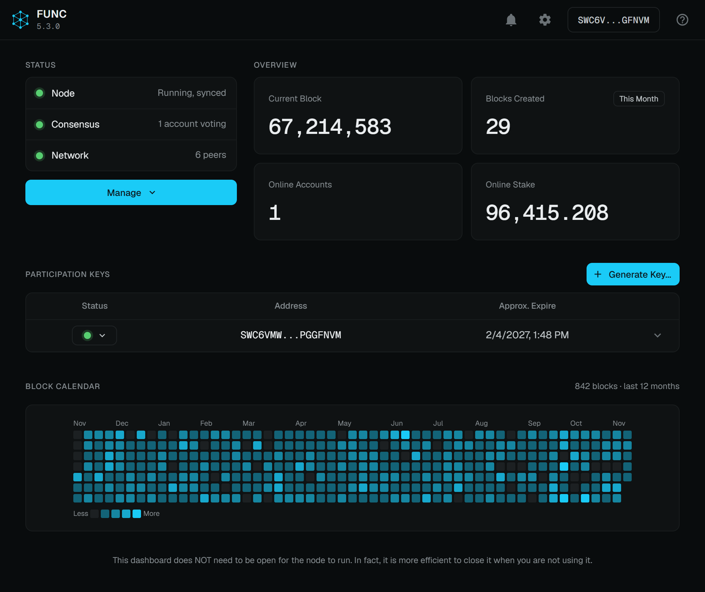

#  Funk's Ultimate Node Controller (FUNC)

FUNC is a cross-platform service that makes it easy to spin up an Algorand node and start participating in consensus.

**📖 Documentation: [func.algo.xyz](https://func.algo.xyz)**



## Install

### Windows

Open PowerShell and run:

```powershell
irm https://raw.githubusercontent.com/GalaxyPay/func/main/install.ps1 | iex
```

### Mac / Linux

```sh
curl -fsSL https://raw.githubusercontent.com/GalaxyPay/func/main/install.sh | sudo sh
```

Then open <http://localhost:3536> and follow [Getting Started](https://func.algo.xyz/getting-started).

Manual installs, uninstalling, remote access and everything else are covered in the [documentation](https://func.algo.xyz).

## Build (for Developers)

You can fork the repo and let Github Actions do the build for you, or you can run:

- [LocalPublish.ps1](LocalPublish.ps1) (Windows)
- [local-publish.sh](local-publish.sh) and [create-package-pkg.sh](create-package-pkg.sh) (Mac)
- [local-publish.sh](local-publish.sh) and [create-package-deb.sh](create-package-deb.sh) (Linux)

To run the web UI from the Vite dev server against an installed FUNC service, point it at that service in `webui/.env.development.local`:

```sh
VITE_ORIGIN=http://localhost:3536
```

The UI talks to algod on the same host, so if the service runs on another machine just use its address (for example `http://192.168.1.100:3536`). The API sends no CORS headers by default, so you also need to allow the dev server's origin on the machine running the service: create a file named `func.json` in the same folder as `auth.json`, with the following contents, then restart the FUNC service:

```json
{ "Cors": { "Origins": ["http://localhost:3000"] } }
```

This file is only needed for development; a normal install never has one.

Note the `create-package` scripts take arguments of version and architecure (`amd64` or `arm64`). For example:

```sh
./create-package-deb.sh 5.2.1 amd64
```

Dependencies include .NET Core 8, Node.js, pnpm, and Inno Setup.

### Documentation

The docs site lives in [docs/](docs) and is built with [VitePress](https://vitepress.dev). Pushing changes under `docs/` to `main` publishes it to [func.algo.xyz](https://func.algo.xyz). To preview it locally:

```sh
cd docs
pnpm install
pnpm dev
```
